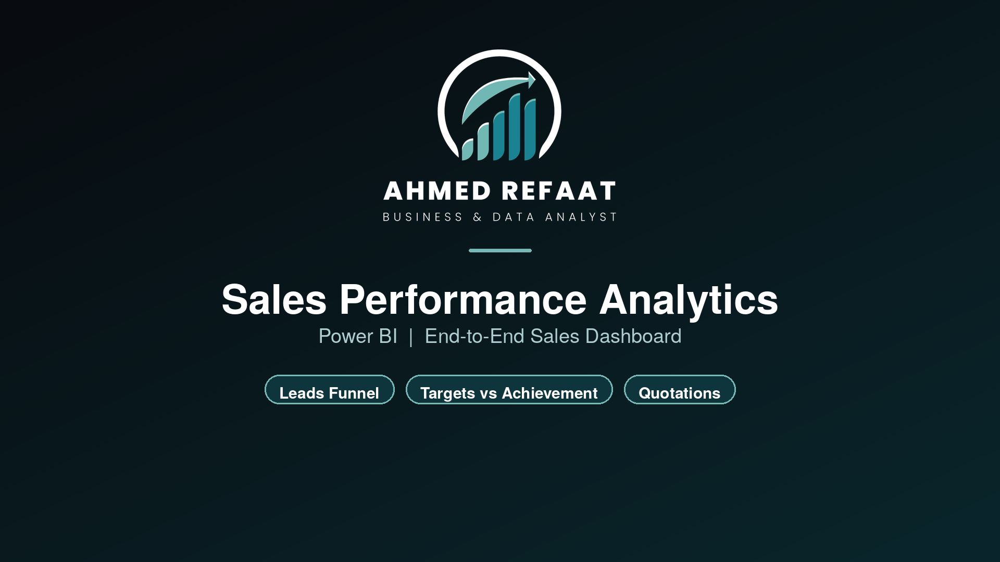
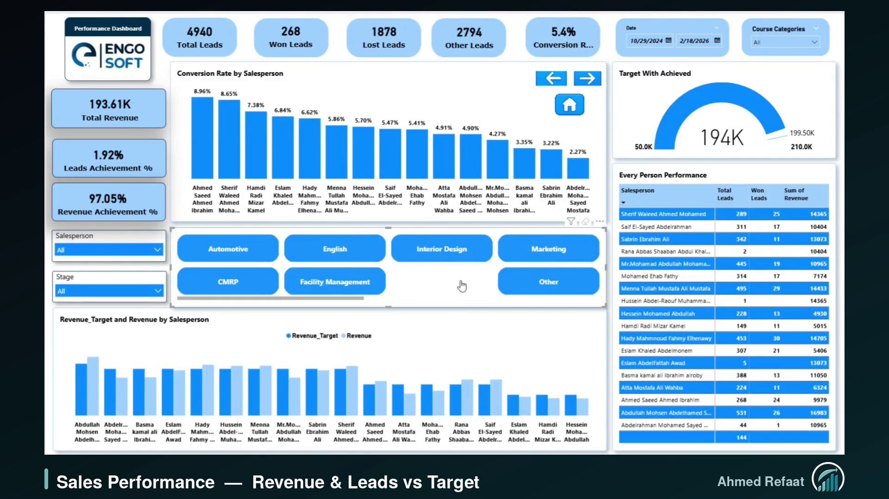
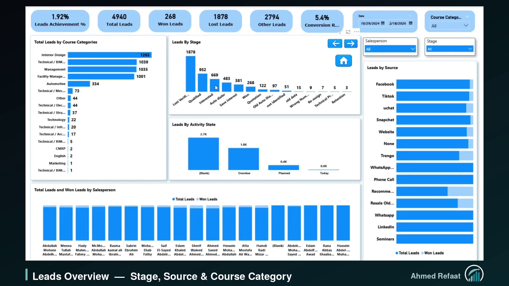
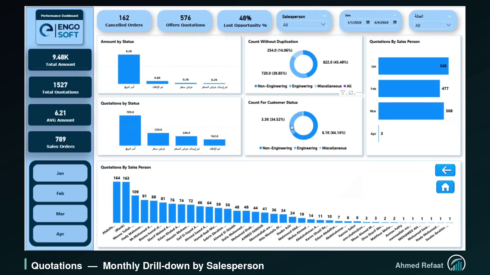

# 📊 Sales Performance Analytics | Power BI

---

## 🖼️ Dashboard Preview

## 🎥 Project Video
&nbsp;|&nbsp; [⬇️ Download Video](Sales_Performance.mp4?raw=true)

---

## ❓ Business Problem
The sales team's data was spread across separate systems: leads in the CRM, quotations in Odoo ERP, calls in the Yeastar PBX, and targets in spreadsheets.
Management had no single place to answer one key question:

> **Where exactly are we winning deals, and where are we losing them?**

---

## 🔍 Overview
An end-to-end Power BI solution that follows every deal from the first lead to the final sales order, built together with the sales team so every KPI reflects how they actually work.

The report includes:

- **Home Page** : App-like navigation hub to jump to any analysis area
- **Sales Performance** : Revenue and leads vs. target, achievement % and conversion rate per salesperson
- **Leads Overview** : Leads by stage, source, course category, and activity state (overdue, planned, today)
- **Quotations** : Pipeline by status and value, lost opportunity %, customer type split, and monthly drill-down
- **Call Analytics** : Call activity per salesperson from Yeastar CDR data (answer rate, missed calls, talk time)

---

## 🧠 What Was Done

**Data Preparation (Power Query)**
- Combined data from **4 sources**: CRM, Odoo ERP, Finance, and Yeastar PBX
- Standardized inconsistent lead stages, lead sources, and salesperson names into clean columns

**Data Modeling**
- Built a multi-source model connecting leads, quotations, revenue, and targets through shared salesperson, course, and month tables
- Designed target tables at different levels: salesperson, course, and month

**DAX**
- Wrote all KPIs as **measures** (not calculated columns) so they respond to every slicer
- Used `DISTINCTCOUNT` on the order reference for quotations, because the ERP export has one row per quotation line, so counting rows would inflate the numbers
- Used `DIVIDE` for all ratios to handle zero values safely

**User Experience**
- Button and bookmark navigation for an app-like experience
- Course category buttons that filter a whole page in one click
- Color palette and visual style chosen based on the client's preferences, for eye comfort and alignment with the company's visual identity

---

## 📈 KPIs Tracked

| Area | KPIs |
|---|---|
| Leads | Total, Won, Lost, Open leads, Conversion Rate |
| Targets | Revenue Achievement %, Leads Achievement % |
| Quotations | Total Quotations, Sales Orders, Cancelled, Lost Opportunity %, Avg Value |
| Calls | Answer Rate %, Not Answered Calls, Total & Avg Talk Duration |

---

## 🎯 Purpose
The purpose of this dashboard is to:

- Give management one view of the full sales cycle, from lead to order
- Compare each salesperson's performance against their targets
- Identify where leads and quotations drop off, so the team can act on it

---

## 🔜 Next Steps
- Move to a full **star schema** with a dedicated date table for month-over-month and year-over-year analysis
- Link call records to salespeople to measure whether call effort drives won deals
- Add a **marketing layer** to connect campaign performance with sales results

---

## 🛠️ Tools
Power BI · Power Query · DAX · Odoo ERP · Excel

---

👤 **Ahmed Refaat** | Business & Data Analyst
